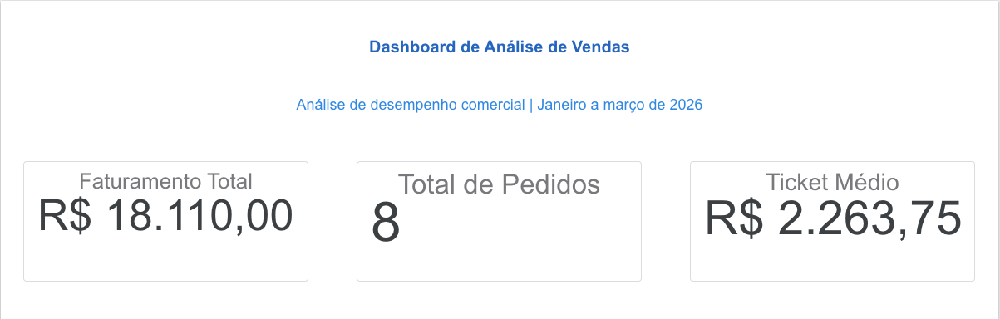
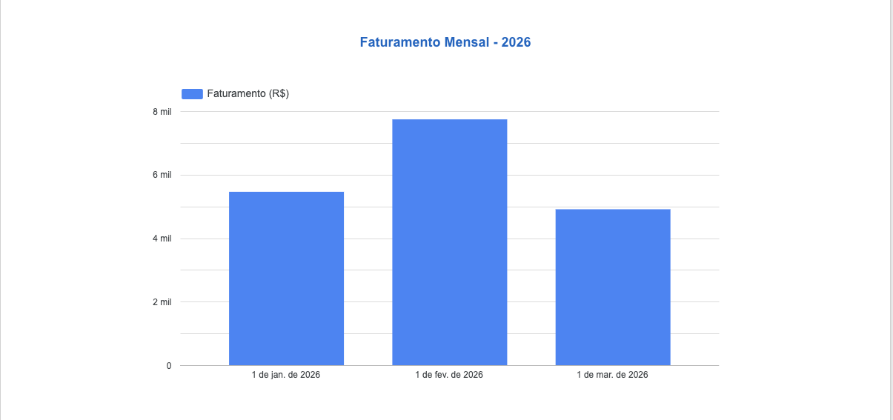
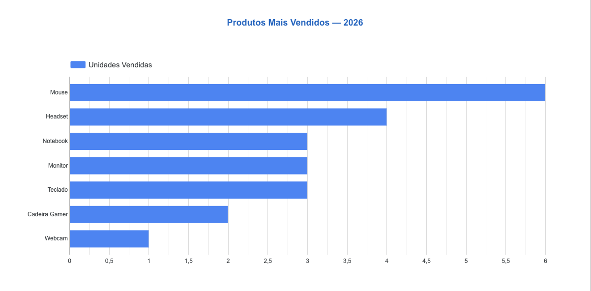
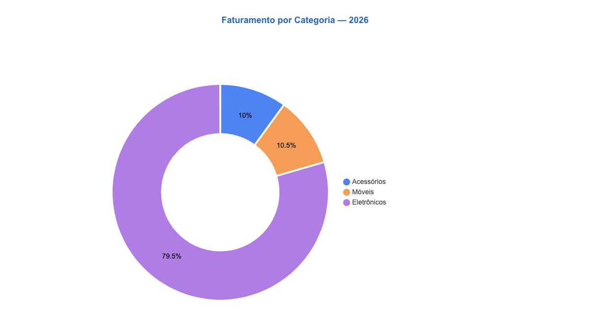
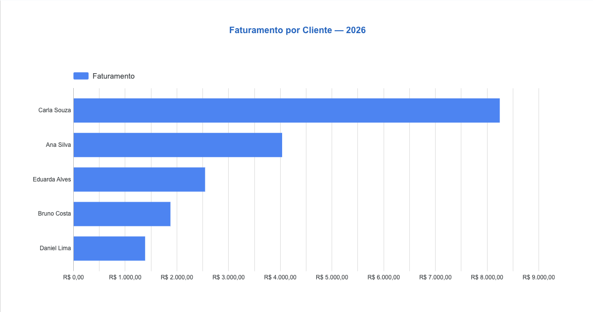

# Projeto de Análise de Vendas com SQL

## Sobre o projeto

Este projeto tem como objetivo realizar uma análise de dados de vendas de uma empresa fictícia, utilizando SQL e PostgreSQL.

A proposta é explorar informações de clientes, produtos, pedidos e itens vendidos, transformando dados em informações úteis para a tomada de decisões empresariais.

## Objetivos

- Consultar e organizar dados utilizando SQL.
- Analisar o comportamento dos clientes.
- Identificar os produtos mais vendidos.
- Calcular o faturamento por pedido.
- Analisar o faturamento por categoria.
- Identificar a evolução das vendas ao longo dos meses.

## Modelagem do banco de dados

O banco de dados foi estruturado em quatro tabelas: clientes, produtos, pedidos e itens_pedido.

A modelagem apresenta os relacionamentos entre as tabelas, utilizando chaves primárias (Primary Keys) e chaves estrangeiras (Foreign Keys), garantindo a organização e integridade dos dados.

## Estrutura do banco de dados

O banco de dados possui quatro tabelas principais:

- **clientes:** informações dos clientes.
- **produtos:** cadastro de produtos, categorias e preços.
- **pedidos:** registros das compras realizadas.
- **itens_pedido:** produtos, quantidades e preços de cada pedido.

## Análises realizadas

Foram desenvolvidas consultas SQL utilizando:

- SELECT e WHERE.
- ORDER BY.
- GROUP BY.
- Funções de agregação, como SUM().
- JOIN entre tabelas.
- DATE_TRUNC para análise mensal.

## Principais resultados

- **Faturamento total:** R$ 18.110,00.
- **Categoria com maior faturamento:** Eletrônicos, com R$ 14.400,00.
- **Mês com maior faturamento:** Fevereiro de 2026, com R$ 7.740,00.
- **Produto com maior quantidade vendida:** Mouse, com 6 unidades.

## Arquivos do projeto

- `01_criacao_banco_dados.sql`: criação das tabelas, relacionamentos e inserção dos dados.
- `02_consultas_analise.sql`: consultas SQL utilizadas nas análises.

## Dashboard de Análise de Vendas

O dashboard foi desenvolvido no Google Data Studio (Looker Studio), utilizando dados extraídos de um banco PostgreSQL por meio de consultas SQL e organizados no Google Sheets.

### Acesse o dashboard interativo

[Clique aqui para visualizar o dashboard no Looker Studio](https://datastudio.google.com/reporting/b59d478c-1145-4691-b408-e6369a6639e1)

### Indicadores principais

- **Faturamento total:** R$ 18.110,00
- **Total de pedidos:** 8
- **Ticket médio:** R$ 2.263,75

### Visualizações do dashboard

**1. Indicadores gerais**

**2. Faturamento mensal**

**3. Produtos mais vendidos**

**4. Faturamento por categoria**

**5. Faturamento por cliente**

### Principais insights

- **Melhor mês de vendas:** fevereiro de 2026, com faturamento de R$ 7.740,00.
- **Produto mais vendido:** Mouse, com 6 unidades comercializadas.
- **Categoria de maior faturamento:** Eletrônicos, responsável por aproximadamente 79,5% da receita total (R$ 14.400,00).
- **Cliente de maior faturamento:** Carla Souza, que liderou o ranking de receita por cliente.
- **Ticket médio:** R$ 2.263,75 por pedido.

**Conclusão:** A análise demonstra uma concentração significativa do faturamento na categoria Eletrônicos. Apesar de o Mouse liderar em quantidade vendida, os produtos eletrônicos representam a maior contribuição financeira para o negócio.

## Tecnologias utilizadas

- **PostgreSQL:** armazenamento e relacionamento dos dados.
- **SQL:** consultas, junções, agregações e análises.
- **DBeaver Community:** execução das consultas e exportação dos resultados.
- **Google Sheets:** organização dos dados para visualização.
- **Google Data Studio (Looker Studio):** construção do dashboard interativo.

## Autora

Projeto desenvolvido como parte dos meus estudos em SQL, PostgreSQL e Análise de Dados.

Este é um projeto de aprendizado prático, com foco no desenvolvimento de habilidades em análise e interpretação de dados.
